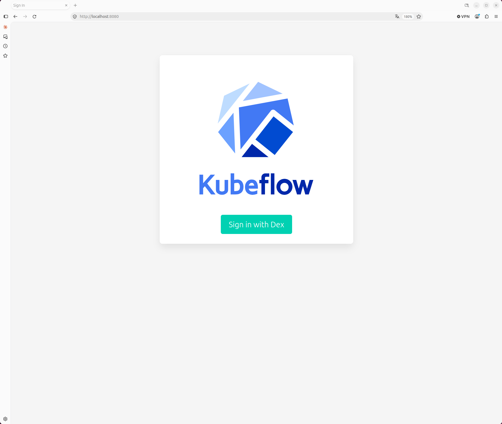
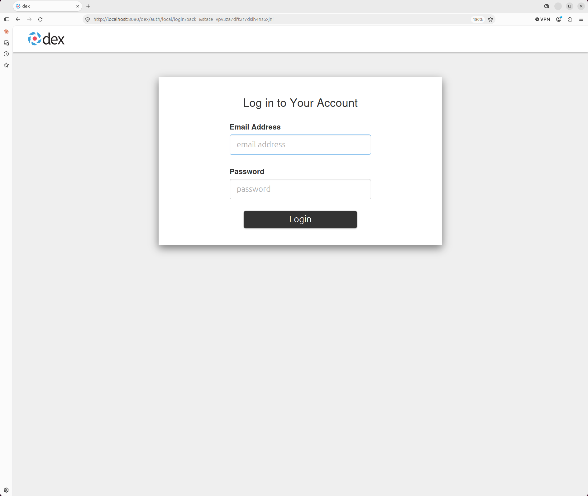
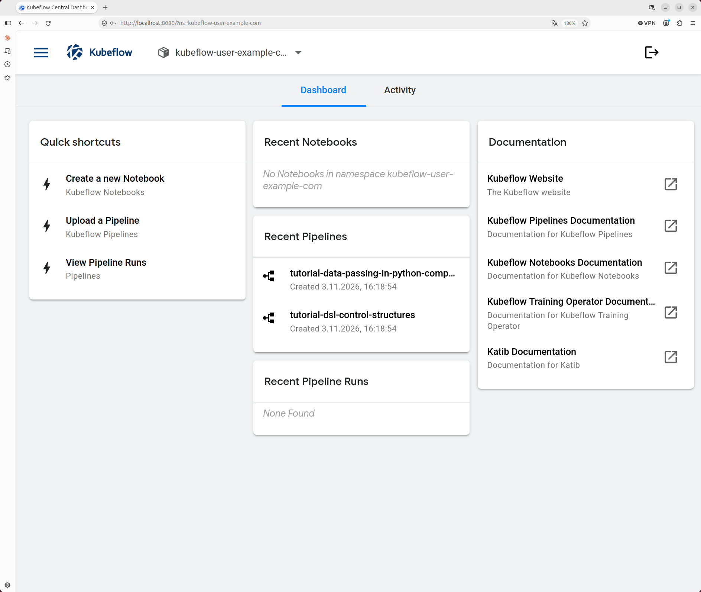
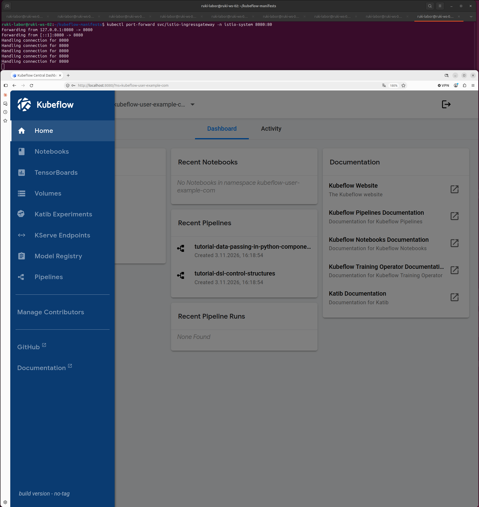
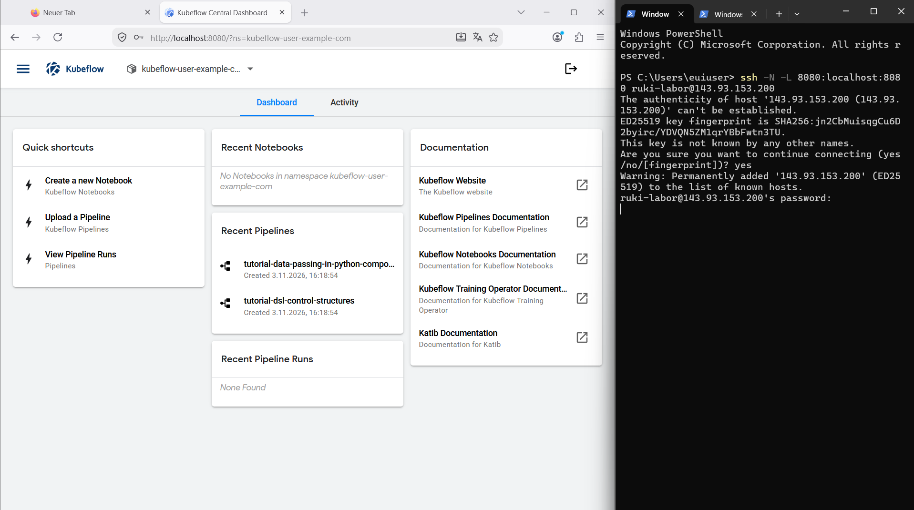

Zurück: [5. Kubeflow installieren](05-kubeflow-installieren.md) | [Übersicht](../README.md)

# 6. Zugriff auf das Dashboard

Aufbau der Befehle (Was, Wo, Erwartet, Prüfen) und Hinweise zur Sprache der Ausgaben: siehe [Übersicht](../README.md#aufbau-jedes-befehls). Quellen: siehe [Übersicht](../README.md#quellen).

Das Central Dashboard ist die Weboberfläche von Kubeflow. Von dort aus erreicht man Notebooks, Pipelines, Katib und die übrigen Komponenten. Nach der Installation aus Abschnitt 5 ist es von außen nicht erreichbar. Das README des Tags `26.03.1` nennt als Standardweg ein Port-Forward auf das Istio Ingress-Gateway (Abschnitt *Port-Forward*).

Abschnitt [6.1](#61-voraussetzung) nennt die Voraussetzung, [6.2](#62-port-forward-starten) startet das Port-Forward, [6.3](#63-anmelden) zeigt die Anmeldung. [6.4](#64-aufbau-des-dashboards) beschreibt die Oberfläche, [6.5](#65-zugriff-von-einem-anderen-rechner) den Zugriff von einem anderen Rechner. [6.6](#66-sicherheitshinweise) fasst die Sicherheitshinweise zusammen.

## 6.1 Voraussetzung

Alle Pods müssen bereit sein, siehe [5.6](05-kubeflow-installieren.md#56-pods-prüfen). Das README weist darauf hin, dass ein Verbindungsversuch vor diesem Zeitpunkt zu unerwarteten Fehlern führen kann (Abschnitt *Connect to Your Kubeflow Cluster*).

## 6.2 Port-Forward starten

```bash
kubectl port-forward svc/istio-ingressgateway -n istio-system 8080:80
```

- **Was:** leitet den lokalen Port `8080` an Port `80` des Service `istio-ingressgateway` weiter. `svc/` steht für Service, kubectl wählt selbst einen Pod hinter diesem Service. `-n istio-system` ist der Namespace des Service. `8080:80` bedeutet lokaler Port links, Port des Service rechts. Ohne die Option `--address` lauscht kubectl nur auf `localhost`, also auf `127.0.0.1` und `::1` (kubectl port-forward, kubernetes.io).
- **Wo:** Terminal des Laborrechners, in einem beliebigen Verzeichnis. Das Terminal bleibt belegt, solange die Weiterleitung läuft. Weitere Befehle in einem zweiten Terminal oder Tab ausführen.
- **Erwartet:** zwei Zeilen `Forwarding from …`, danach kehrt die Eingabeaufforderung nicht zurück.
- **Prüfen:** Jede Anfrage aus dem Browser (6.3) erzeugt im Terminal eine Zeile `Handling connection for 8080`.

Beispiel (ruki-ws-02, 03.11.2026), nach den ersten Aufrufen im Browser:

```
Forwarding from 127.0.0.1:8080 -> 8080
Forwarding from [::1]:8080 -> 8080
Handling connection for 8080
Handling connection for 8080
Handling connection for 8080
```

**Beenden:** `Strg+C` im Terminal des Port-Forwards. Danach ist das Dashboard nicht mehr erreichbar. Die Weiterleitung endet auch von selbst, wenn der gewählte Pod beendet wird, zum Beispiel bei einem Neustart des Ingress-Gateways. Dann den Befehl erneut ausführen (kubectl port-forward, kubernetes.io).

## 6.3 Anmelden

Die Anmeldung läuft in drei Schritten im Browser des Laborrechners.

**Schritt 1: Seite von oauth2-proxy.** `http://localhost:8080` öffnen. Das README beschreibt als ersten Bildschirm direkt die Anmeldung von Dex (Abschnitt *Port-Forward*). Bei 26.03.1 erscheint vorher eine Seite von oauth2-proxy mit dem Kubeflow-Logo und dem Button *Sign in with Dex* (eigene Beobachtung auf ruki-ws-02 und über den Tunnel aus 6.5, 03.11.2026). Auf den Button klicken.



*Abbildung 6.1: Seite von oauth2-proxy (eigene Aufnahme, ruki-ws-02, 03.11.2026).*

**Schritt 2: Anmeldeformular von Dex.** Es erscheint das Formular *Log in to Your Account* mit den Feldern *Email Address* und *Password*. Die Adresse beginnt mit `http://localhost:8080/dex/auth/local/login`. Der Standardbenutzer der Manifeste hat die E-Mail-Adresse `user@example.com` und das Passwort `12341234` (README, Abschnitt *Port-Forward*). Zu diesem Passwort siehe [6.6](#66-sicherheitshinweise).



*Abbildung 6.2: Anmeldeformular von Dex (eigene Aufnahme, ruki-ws-02, 03.11.2026).*

**Schritt 3: Central Dashboard.** Nach *Login* öffnet sich das Dashboard unter `http://localhost:8080/?ns=kubeflow-user-example-com`. Der Parameter `ns` ist der Namespace, mit dem das Dashboard arbeitet, hier das Profil des Standardbenutzers.

- **Prüfen:** Oben neben dem Kubeflow-Logo steht der Namespace `kubeflow-user-example-c…` (gekürzt). In den Karten erscheinen keine Fehlermeldungen.



*Abbildung 6.3: Central Dashboard, Namespace kubeflow-user-example-com (eigene Aufnahme, ruki-ws-02, 03.11.2026).*

## 6.4 Aufbau des Dashboards

**Kopfzeile.** Links das Menüsymbol und die Auswahl des Namespace, rechts das Symbol zum Abmelden.

**Reiter.** *Dashboard* und *Activity*. Der Reiter *Dashboard* enthält fünf Karten:

| Karte | Inhalt |
|---|---|
| Quick shortcuts | Links zu *Create a new Notebook*, *Upload a Pipeline* und *View Pipeline Runs* |
| Recent Notebooks | Die letzten Notebooks im gewählten Namespace |
| Recent Pipelines | Die zuletzt hochgeladenen Pipelines |
| Recent Pipeline Runs | Die letzten Pipeline-Läufe |
| Documentation | Links zur Dokumentation von Kubeflow, Pipelines, Notebooks, Training Operator und Katib |

Beispiel (ruki-ws-02, 03.11.2026), direkt nach der Installation: *Recent Notebooks* zeigt `No Notebooks in namespace kubeflow-user-example-com`, *Recent Pipeline Runs* zeigt `None Found`. Unter *Recent Pipelines* stehen bereits `tutorial-data-passing-in-python-components` und `tutorial-dsl-control-structures`, beide mit `Created 3.11.2026, 16:18:54`. Diese beiden Pipelines wurden nicht von Hand hochgeladen.

**Menü.** Das Menüsymbol oben links öffnet die Navigation: *Home*, *Notebooks*, *TensorBoards*, *Volumes*, *Katib Experiments*, *KServe Endpoints*, *Model Registry*, *Pipelines*, darunter *Manage Contributors*, *GitHub* und *Documentation*.

Ganz unten im Menü steht `build version - no-tag`, obwohl der Tag `26.03.1` installiert ist (eigene Beobachtung, ruki-ws-02, 03.11.2026). Die Ursache ist nicht geklärt.

<!-- TODO: Herkunft von "build version - no-tag" klären -->



*Abbildung 6.4: Menü des Dashboards, oben das Terminal mit dem laufenden Port-Forward (eigene Aufnahme, ruki-ws-02, 03.11.2026).*

## 6.5 Zugriff von einem anderen Rechner

Das Port-Forward aus 6.2 lauscht nur auf `localhost` des Laborrechners. Von einem anderen Rechner aus erreicht man das Dashboard über einen SSH-Tunnel. Der Browser ruft dabei weiterhin `http://localhost:8080` auf. Das ist wichtig, weil Kubeflow über HTTP nur unter `localhost` funktioniert (siehe [6.6](#66-sicherheitshinweise)).

| Fall | Situation | Vorgehen |
|---|---|---|
| A | Browser auf dem Laborrechner selbst | Kein Tunnel nötig, direkt 6.3. Getestet auf ruki-ws-02 am 03.11.2026. |
| B | Browser auf einem anderen Rechner mit SSH-Client | SSH-Tunnel wie unten. Getestet von einem Windows-PC (PowerShell) am 03.11.2026. |

```
ssh -N -L 8080:localhost:8080 <Benutzer>@<IP-des-Laborrechners>
```

- **Was:** baut eine SSH-Verbindung zum Laborrechner auf. `-L 8080:localhost:8080` öffnet Port `8080` auf dem eigenen Rechner und leitet alles, was dort ankommt, durch die SSH-Verbindung an `localhost:8080` auf dem Laborrechner weiter, also an das Port-Forward aus 6.2. `-N` startet keine Shell auf dem Laborrechner, die Verbindung dient nur dem Tunnel. Alle Optionen beschreibt `man ssh`.
- **Wo:** PowerShell (Windows) oder Terminal (Linux, macOS) auf dem anderen Rechner. Das Port-Forward aus 6.2 muss auf dem Laborrechner laufen.
- **Erwartet:** Bei der ersten Verbindung fragt SSH, ob dem Host-Schlüssel des Laborrechners vertraut werden soll, Antwort `yes`. Danach die Abfrage des Passworts. Nach der Eingabe erscheint keine weitere Ausgabe, das Fenster bleibt belegt.
- **Prüfen:** `http://localhost:8080` im Browser des anderen Rechners zeigt die Seite aus Abbildung 6.1. Im Terminal des Port-Forwards auf dem Laborrechner erscheinen neue Zeilen `Handling connection for 8080`.

**Beenden:** `Strg+C` im Fenster des Tunnels.

Beispiel (Windows-PC, PowerShell, 03.11.2026):

```
PS C:\Users\euiuser> ssh -N -L 8080:localhost:8080 ruki-labor@143.93.153.200
The authenticity of host '143.93.153.200 (143.93.153.200)' can't be established.
ED25519 key fingerprint is SHA256:jn2CbMuisqgCu6D2byirc/YDVQN5ZM1qrYBbFwtn3TU.
This key is not known by any other names.
Are you sure you want to continue connecting (yes/no/[fingerprint])? yes
Warning: Permanently added '143.93.153.200' (ED25519) to the list of known hosts.
ruki-labor@143.93.153.200's password:
```

Ablauf und Seiten im Browser sind dieselben wie in 6.3, einschließlich der Seite *Sign in with Dex*.



*Abbildung 6.5: Dashboard über den SSH-Tunnel, rechts PowerShell mit dem Tunnel (eigene Aufnahme, Windows-PC, 03.11.2026).*

## 6.6 Sicherheitshinweise

**Standardpasswort.** `user@example.com` mit `12341234` gilt für jede Installation aus diesen Manifesten. Das README empfiehlt, das Passwort für jede produktive Installation zu ändern. Das Vorgehen steht im README, Abschnitt *Change Default User Password*: ein bcrypt-Hash des neuen Passworts, danach das Secret `dex-passwords` im Namespace `auth` neu anlegen und die Pods in `auth` neu starten. Auf ruki-ws-02 bleibt vorerst das Standardpasswort.

**Zugriff ohne `localhost`.** Wer Kubeflow über NodePort, LoadBalancer oder Ingress erreichbar machen will, braucht HTTPS. Mehrere Web-Anwendungen von Kubeflow verwenden Secure Cookies, deshalb funktioniert HTTP unter einer anderen Adresse als `localhost` nicht (README, Abschnitt *NodePort / LoadBalancer / Ingress*). Das README rät außerdem, den Service `istio-ingressgateway` nur als `ClusterIP` zu betreiben und nicht als NodePort. Die Secure Cookies lassen sich mit `APP_SECURE_COOKIES=false` abschalten, das README empfiehlt das aber ausdrücklich nicht. Der SSH-Tunnel aus 6.5 umgeht das Problem, weil der Browser weiterhin `localhost` aufruft.

Weiter: 7. Erster Test: Pipeline mit GPU-Schritt (folgt) | [Übersicht](../README.md)
